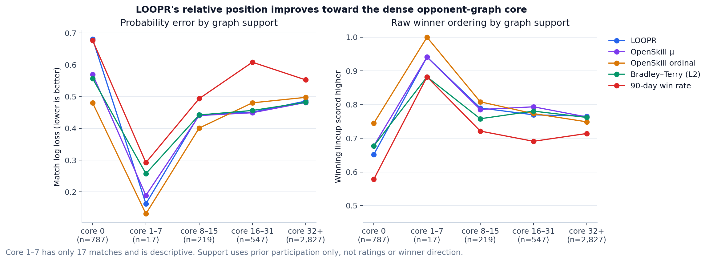
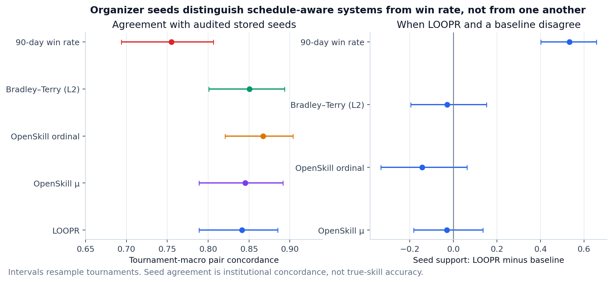
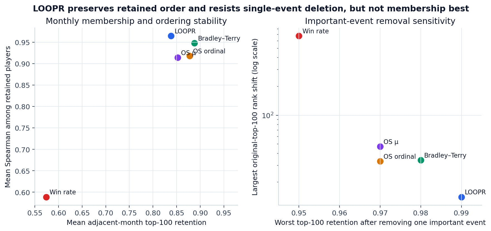
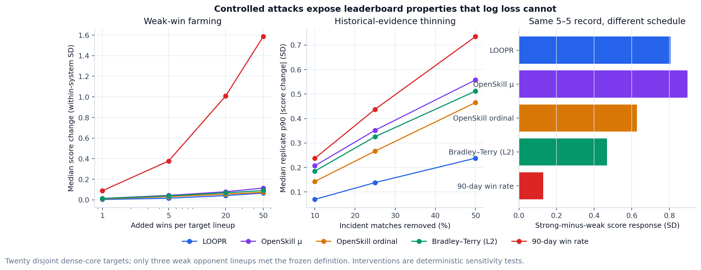
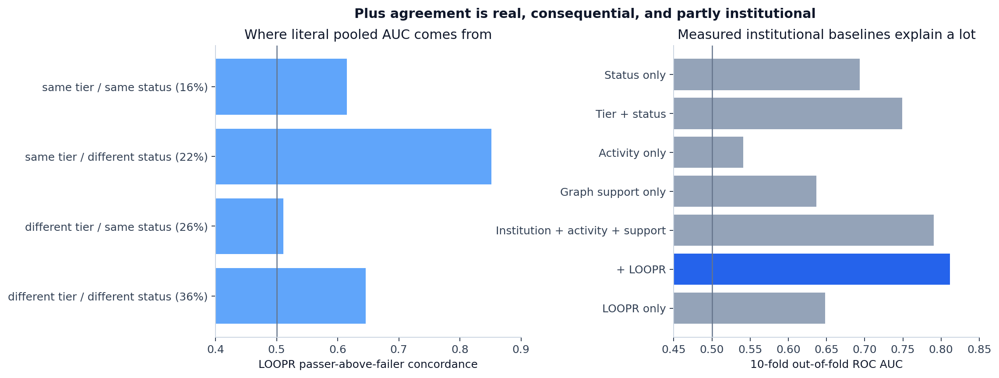

# Public-ranking intended-use evaluation

## Bottom line

**The old evaluation was not wrong; it was asking one valid question and letting that answer stand in for several others.** Walk-forward log loss asks whether a score produces good probabilities for any future match. A public player ranking also needs defensible ordinal behavior in the well-supported graph, resistance to strategic volume and weak-opponent farming, continuity at the visible top, robustness to data perturbations, and convergence with historical ordering decisions. Those are separate hypotheses.

The added evidence changes the verdict from “LOOPR is a somewhat worse predictor” to a requirements profile:

- LOOPR is genuinely weak at the sparse edge. On **787 core-0 matches**, its log loss was **0.681**, versus **0.480** for OpenSkill ordinal.
- In the dense core, the systems become much harder to distinguish. Across **2,827 core-32+ matches** (64.3% coverage), LOOPR log loss was **0.486**, OpenSkill μ **0.481**, and Bradley–Terry **0.482**. Tournament-cluster intervals for μ-minus-LOOPR and BT-minus-LOOPR include zero. LOOPR had the highest raw ordering accuracy by a small amount (**0.765**).
- Historical seeds are meaningful as an ordering artifact, but they do not uniquely favor LOOPR. OpenSkill ordinal has the highest point estimate; paired model-disagreement intervals do not distinguish LOOPR from the three schedule-aware alternatives.
- LOOPR's clearest comparative strengths are operational: retained-player order, important-event deletion, weak-win farming, volume duplication, and history thinning. Bradley–Terry, however, retains top-100 membership better month to month, and OpenSkill μ responds slightly more strongly to schedule quality.
- Plus agreement is consequential but partly institutional. Candidate status alone reaches **0.693** out of fold; tier plus status reaches **0.749**. Adding LOOPR to institution, activity, and graph support increases AUC from **0.790** to **0.812** and improves log loss by **0.014**.

**Conclusion:** existing data support treating LOOPR as a ranking-oriented, outcome-derived skill-o-meter for established organized-play competitors. They do not establish that it is the universally best public ranking, that it handles new players well, or that every exact neighboring rank is meaningful.

## Direct answers to the requested deliverables

| number | question | answer |
| --- | --- | --- |
| 1 | Are we evaluating the wrong target? | Partly. Walk-forward prediction is a valid generalization test, but it was carrying too much argumentative weight. Public-ranking quality is a separate, multidimensional hypothesis. |
| 2 | What existing data better measures public-ranking quality? | Pre-event tournament seeds, Plus decisions, opponent-graph support, monthly top lists, tournament-removal perturbations, repeated lineups, and the match graph used for controlled attacks. |
| 3 | Which metrics should become primary? | A no-composite profile: dense-core ordinal performance and coverage, audited seed concordance/disagreements, adversarial degradation, top-100 membership plus retained order, important-event robustness, and decomposed Plus convergence. |
| 4 | Which metrics should become secondary? | All-match walk-forward log loss remains the primary generalization metric; Brier score, calibration, and overall accuracy are secondary probability evidence. Half-life and unfamiliar-lineup results remain technical scope checks. |
| 5 | Which current metrics measure a different construct? | Log loss, Brier score, and reliability measure probability quality; Plus AUC measures institutional agreement; stability and retention measure continuity; tournament removal measures sensitivity. None alone is public-ranking quality or exact-rank accuracy. |
| 6 | What analyses should be added? | Predeclared graph-support strata, historical seed provenance/meaning audit, model-seed disagreement pairs, all-system stability and event deletion, weak-win/volume/thinning/schedule/transitive interventions, and pooled Plus decomposition with its exact shuffle null. |
| 7 | What should be removed or demoted? | Remove nothing. Demote average probability metrics from decisive leaderboard evidence; keep the non-discriminating transitive-chain test and detailed parameter/property sweeps in technical material. |
| 8 | Which Part I conclusions should change? | Replace both ‘worse predictor, therefore weak’ and ‘works, therefore best leaderboard’ with a support-bounded claim: LOOPR is a strong ranking-oriented outcome instrument for established competitors, with sparse-edge failure and no proof of exact-rank legitimacy. |

## 1. Two targets, kept separate

**Generalization** asks: *Does the score contain information about any future match?* The formal primary metric is walk-forward log loss. It remains in the report unchanged. It is valuable because it is temporal, falsifiable, and punishes confident errors. Its limitation is construct mismatch: average probability quality weights every held-out match and is sensitive to calibration, including the sparse edge where LOOPR was not designed to dominate.

**Intended use** asks: *Does the system produce a usable public ordering among established competitors, and does that ordering degrade gracefully under pressure?* No single observed field is a ground-truth public ranking. The defensible approach is a predeclared requirements profile, not a replacement scalar optimized after results.

The measured construct remains:

> LOOPR estimates a player's demonstrated ability to convert organized-play match opportunities into tournament victories, given the available network of teammates, opponents, events, and results.

That construct can include communication, leadership, adaptation, team formation, and other contributions to wins. It can also contain access, opportunity, teammate quality, and network position. Part I can measure the instrument; Part II must still address whether publishing exact named ranks is legitimate.

## 2. Graph support: where can the ranking see enough?

The primary support metric is **opponent-graph k-core number**, computed before each held-out tournament without model scores or winner direction. A player in the k-core belongs to a recursively defined subgraph in which every retained player has at least k distinct opponent connections. A match qualifies only if every participant meets the threshold. This asks whether all players in the comparison sit inside a redundant competitive network rather than on an isolated edge.

The thresholds (1, 2, 4, 8, 16, 32) and disjoint bands were frozen before model-by-support results. Relative LOOPR loss improves with support against every substantive baseline: slope estimates for baseline-minus-LOOPR loss versus log2(1+minimum core) are OpenSkill μ +0.014 [+0.007, +0.020], OpenSkill ordinal +0.029 [+0.019, +0.039], Bradley–Terry (L2) +0.016 [+0.008, +0.023], 90-day win rate +0.008 [-0.001, +0.017]. Positive slopes mean LOOPR improves relative to the named baseline as support rises.

**Interpretation.** The dense center is not a post-hoc rescue subgroup. It is defined topologically, without ratings or outcome direction, and contains 64.3% of held-out matches at core 32+. At that support, the available data do not clearly separate LOOPR, OpenSkill μ, and Bradley–Terry on probability quality, and LOOPR slightly leads raw winner ordering. At core 0, LOOPR is decisively worse.

**Limitation.** k-core captures opponent connectivity, not all evidence quality. Dense graph membership cannot remove access or teammate confounding, and a held-out team win is not an objective player ordering.

## 3. Historical organizer seeds

### Are the seeds meaningful?

The repository contains **1,931** canonical tournaments with at least one stored seed and **1,601** complete 1..N permutations. The predeclared structural audit retains **124** ranked tournaments: at least eight teams, stable complete seeds, adequate rosters, and a simple one-dimensional first stage. Only **3** tournaments show any team seed change across available snapshots.

Provenance remains partly unknowable. There is no repository field saying manual, random, copied, or automatic. What the data do show is:

- **Registration order:** zero of 124 structurally eligible seed lists exactly equals registration order; median Spearman correlation is -0.139.
- **Stored automatic suggestion:** only one list exactly equals `avgSeedingSkillOrdinal`, but median correlation is 0.883. The plausible interpretation is that this field often informed the order and organizers or software changed some positions. The data cannot identify who changed what.
- **Previous-event reuse:** among 486 structurally eligible exact-roster repeats, only 9.9% retain the identical integer seed; median absolute relative-seed change is 0.182. Pure mechanical copying is not the dominant observed pattern, but partial copying cannot be ruled out.
- **Not random in aggregate:** the higher seed wins 73.8% of matches tournament-macro (95% cluster interval 72.2%–75.3%).

Useful information is not confined to the first few seeds:

| Best seed in match | Matches | Higher seed won (macro) | 95% low | 95% high |
| --- | --- | --- | --- | --- |
| top 4 | 1791 | 0.753 | 0.732 | 0.775 |
| 5-8 | 928 | 0.711 | 0.671 | 0.751 |
| 9+ | 743 | 0.692 | 0.629 | 0.753 |

### Which model matches the stored order?

Model comparison begins on 2025-08-17 and requires exactly four active roster ids, leaving **23 tournaments and 2,806 team pairs**. Ratings use only pre-event information.

| System | Seed concordance | 95% low | 95% high |
| --- | --- | --- | --- |
| LOOPR | 0.841 | 0.789 | 0.885 |
| OpenSkill μ | 0.845 | 0.789 | 0.891 |
| OpenSkill ordinal | 0.867 | 0.821 | 0.904 |
| Bradley–Terry (L2) | 0.850 | 0.801 | 0.893 |
| 90-day win rate | 0.755 | 0.694 | 0.806 |

When LOOPR and OpenSkill μ disagree, seeds favor LOOPR on 47.4% of pairs; the paired tournament-macro LOOPR-minus-μ difference is -0.030 (95% interval -0.183 to +0.136). The corresponding interval includes zero for μ, ordinal, and Bradley–Terry. Against 90-day win rate, seeds favor LOOPR on 74.8%, clearly above chance.

**Answer:** seeds are useful evidence of organizer-controlled ordering, but not verified manual expert labels. They separate schedule-aware ratings from raw win rate; they do not show that LOOPR uniquely captures organizer judgment.

## 4. The public-ranking requirements profile

No composite score is reported. Choosing weights after results would recreate the target problem in a less visible form.

| System | Core32 log loss ↓ | Core32 ordering ↑ | Seed concordance ↑ | Monthly top100 retention ↑ | Retained-order ρ ↑ | Monthly p90 move ↓ | Worst event retention ↑ | Largest event shift ↓ | 50 weak wins ΔSD ↓ | Weak/strong ratio ↓ | 5× volume p90 ΔSD ↓ | 50% thin top100 ↑ | 50% thin pair order ↑ | 50% thin p90 ΔSD ↓ | Equal-record schedule gap ↑ |
| --- | --- | --- | --- | --- | --- | --- | --- | --- | --- | --- | --- | --- | --- | --- | --- |
| LOOPR | 0.486 | 0.765 | 0.841 | 0.838 | 0.965 | 12.800 | 0.990 | 14.000 | 0.066 | 0.096 | 0.124 | 0.950 | 0.938 | 0.238 | 0.805 |
| OpenSkill μ | 0.481 | 0.763 | 0.845 | 0.852 | 0.914 | 19.600 | 0.970 | 47.000 | 0.115 | 0.109 | 0.409 | 0.885 | 0.890 | 0.558 | 0.895 |
| OpenSkill ordinal | 0.498 | 0.749 | 0.867 | 0.878 | 0.918 | 21.000 | 0.970 | 33.000 | 0.074 | 0.094 | 0.225 | 0.910 | 0.922 | 0.465 | 0.627 |
| Bradley–Terry (L2) | 0.482 | 0.762 | 0.850 | 0.888 | 0.948 | 15.500 | 0.980 | 34.000 | 0.090 | 0.075 | 0.230 | 0.880 | 0.903 | 0.512 | 0.468 |
| 90-day win rate | 0.553 | 0.714 | 0.755 | 0.574 | 0.589 | 40.200 | 0.950 | 676.000 | 1.585 | 0.906 | 0.634 | 0.760 | 0.816 | 0.735 | 0.129 |

### Stability

LOOPR's mean monthly top-100 membership retention is 83.8%, below Bradley–Terry's 88.8%. Among retained players, LOOPR has the highest mean Spearman correlation (0.965) and the smallest median transition p90 movement (12.8 ranks). This is a real tradeoff: LOOPR is not best at keeping the same names, but it is best at preserving the ordering of names that remain.

### Important-event removal

The old 665-event LOOPR leave-one-out analysis remains. The new all-system comparison removes the 25 events with the most active 8-core player-match appearances, selected without scores or winner direction. LOOPR's median top-100 retention is 100.0%, worst retention 99.0%, and largest observed original-top-100 shift 14. The corresponding largest shifts are 34 for Bradley–Terry, 33 for OpenSkill ordinal, and 47 for μ. This is LOOPR's clearest operational advantage.

Stability and robustness are not accuracy. They establish that the displayed ordering is not usually controlled by one event or minor monthly perturbation.

## 5. Actual adversarial interventions

Twenty disjoint target lineups were chosen by stable player-id hash from active players with at least 20 prior matches, 8-core support, and an observed exact-four lineup used at least three times. Opponents and targets were selected without any evaluated model score. Three weak and fifteen strong lineups met the frozen trailing-90-day definitions.

### Weak-win farming

After 50 added wins against weak lineups, LOOPR's median target-lineup score change is **0.066 within-system SD**, compared with 0.115 for OpenSkill μ, 0.074 for ordinal, 0.090 for Bradley–Terry, and 1.585 for recent win rate. No LOOPR target lineup creates a new top-100 entrant in this attack.

LOOPR still rewards strong wins: its weak-to-strong response ratio at 50 wins is 0.096. That matters because a system that ignores every win would look farming-resistant for the wrong reason.

### Same record, different schedule

The controlled 5–5 record produces a strong-minus-weak response gap of **0.805 SD** for LOOPR, second to OpenSkill μ at 0.895. Bradley–Terry is 0.468; recent win rate is 0.129. LOOPR does not uniquely account for schedule, but it does so strongly.

### Volume duplication

Duplicating each target lineup's deterministic block of up to ten recent exact-lineup matches fivefold yields a LOOPR p90 absolute score movement of **0.124 SD**, the smallest in the comparison. This supports resistance to duplicated evidence, not exact volume cancellation.

### Evidence thinning

Removing half of matches incident to target players over ten deterministic hash replicates leaves LOOPR median full top-100 retention at **95.0%**, target-pair order retention at **93.8%**, and median replicate p90 score movement at **0.238 SD**. LOOPR moves least on the last measure. This is a strong low-evidence degradation result, although it does not isolate which LOOPR component creates the protection.

### Transitive chain

Every model shifts A above C after adding A-over-B and B-over-C chains with no A-C match; at 20 repetitions, the fraction positive is 100% for LOOPR and 100% for the weakest baseline. This test confirms intended direction but does **not** distinguish LOOPR—the simple win-rate model also passes. It should stay in a technical appendix rather than become a success headline.

**Adversarial limitation.** These interventions identify behavior under specified attacks. They do not establish complete Goodhart resistance, and the weak-lineup pool is narrow.

## 6. Plus: decomposing the institutional result

Keep three different quantities separate:

- **Literal pooled AUC = 0.651.** This asks whether a randomly chosen passer from the whole candidate pool is scored above a randomly chosen failer. Cross-tier and cross-status comparisons count because they were part of the institution.
- **Tier-macro institutional AUC = 0.777.** This asks the same question within tier, then gives each tier equal weight.
- **Within-tier/status pair-weighted AUC = 0.615.** This narrower estimand asks what happens when tier and candidate status match. It is not “cleaner”; it deliberately removes much of the institution.

| Pair type | Pairs | Share | Concordance | Pooled-AUC contribution |
| --- | --- | --- | --- | --- |
| same tier / same status | 3500 | 15.8% | 0.615 | 0.097 |
| same tier / different status | 4882 | 22.0% | 0.851 | 0.187 |
| different tier / same status | 5812 | 26.2% | 0.511 | 0.134 |
| different tier / different status | 7982 | 36.0% | 0.646 | 0.232 |

Same-tier/same-status pairs are only 15.8% of all passer-failer pairs. Same-tier/different-status pairs have concordance 0.851; candidate status is therefore a major source of pooled agreement.

All 310 evaluated candidates are already in the pre-vote 32-core (median core 155). Support stratification is identical at every predeclared threshold; it cannot explain within-sample variation. This is an important scope result: the Plus analysis is already an established-player analysis.

The ten-fold out-of-fold model using tier, status, activity, and graph support reaches AUC **0.790**. Adding LOOPR reaches **0.812**. This is out-of-fold evidence of incremental information, but the improvement is modest and has no separate uncertainty interval.

The new literal pooled outcome shuffle preserves participation, lineups, events, timestamps, and match volume while independently flipping winner direction. Across 200 full LOOPR recomputations, mean pooled AUC is **0.503** with a 95% range **0.431–0.569**; none reaches the observed 0.651 (corrected p=0.005). Outcome direction adds information beyond participation structure. It does not erase institutional status or access effects.

## 7. What a tournament organizer might mean by “this ranking is really good”

| hypothesis | historical_test | testable_now | interpretive_limit |
| --- | --- | --- | --- |
| The ranking puts the teams I would seed highly near the top. | Audited historical team seeds; pair concordance; model-disagreement pairs. | Yes | Useful institutional convergence, not proof that either ordering is correct. |
| The ordering makes sense among established teams, not just newcomers. | Predeclared opponent-graph k-core strata and dense-core held-out ordering. | Yes | Dense support is defined without scores or winner direction; coverage must be shown. |
| A hard schedule is rewarded more than the same record against weak teams. | Equal-record strong-versus-weak intervention for all five systems. | Yes | Strong/weak labels use historical outcomes and only three weak lineups qualify. |
| Players cannot climb mainly by grinding easy matches. | Weak-win farming and volume-duplication interventions. | Yes | Tests specified attacks, not every strategic adaptation available to players. |
| The visible top list does not jump around for trivial reasons. | Monthly membership/order stability, history thinning, and important-event removal. | Yes | Stability is not accuracy, and activity eligibility can create real churn. |
| The ranking agrees with what the community already recognizes. | Plus pooled/tier/status decomposition and outcome-shuffle null. | Partly | Candidate status explains much of the vote; one snapshot is not universal consensus. |
| The ranking is understandable, legitimate, and safe to publish with names. | No historical behavioral or institutional artifact in the repository directly identifies this. | No | Belongs to Part II; measurement results cannot answer legitimacy by proxy. |
| The ranking reduces organizer workload or improves bracket quality. | No saved organizer workflow, edit log, counterfactual bracket, or workload measure. | No | Seed agreement is the closest artifact, but it does not measure labor saved or bracket quality. |

The historical data can test ordering concordance, dense-center behavior, schedule response, farming resistance, and operational continuity. They cannot identify whether organizers find the ranking legitimate, understandable, socially safe, or labor-saving. Those are not missing statistical controls; they are different questions.

## 8. Recommended metric hierarchy

| priority | metric | plain_language_question | formal_definition | intuitive_interpretation | limitation |
| --- | --- | --- | --- | --- | --- |
| Primary intended-use evidence | Dense-core raw ordering accuracy | Among future matches supported by many opponent paths, is the winning lineup ordered above the losing lineup? | Share of held-out matches with positive pre-event raw team-score difference, stratified by predeclared k-core support. | Directly tests ordinal usefulness where the ranking is designed to operate. | A match winner is still a team outcome, not a ground-truth player order. |
| Primary intended-use evidence | Historical seed concordance and disagreement pairs | Does a pre-event ranking reproduce organizer-controlled team ordering, especially when models disagree? | Tournament-macro team-pair concordance and paired disagreement preference. | Existing consequential ordering artifact closer to how rankings are used. | Seed provenance is undocumented and organizers may consult similar rating inputs. |
| Primary intended-use evidence | Adversarial degradation profile | Can a player move by farming weak wins or duplicating volume, and what happens when evidence is thinned? | Rank and standardized-score change under identical controlled interventions for all systems. | Tests leaderboard failure modes rather than average prediction. | Synthetic interventions are sensitivity tests, not frequencies of real abuse. |
| Primary intended-use evidence | Top-ranking stability and event-removal robustness | Does the visible top ranking change gracefully over time and when one important event is removed? | Top-100 retention, retained-player Spearman/movement, and full refit after event deletion. | Operationally central for a public ranking. | A stable or robust ranking can still be wrong. |
| Primary convergent evidence | Plus institutional and decomposed AUC | Does the score agree with the actual peer-vote institution, and which pair types create that agreement? | Pooled AUC, tier-macro AUC, exact pair decomposition, OOF baselines, and outcome-shuffle null. | Tests convergence with an existing consequential community judgment. | One vote includes reputation, visibility, status, and opportunity; it is not ground truth. |
| Secondary generalization evidence | Walk-forward log loss | Does the rating contain information about any future match, with confidence punished when wrong? | Negative log predicted probability for the winner, micro and tournament-macro. | Essential evidence that scores generalize beyond fitted history. | Optimizes probability quality across a heterogeneous graph, not public-ranking utility. |
| Secondary probability evidence | Brier score and calibration | Do stated probabilities correspond to observed frequencies? | Squared probability error and equal-count reliability bins. | Important if the score is used as a probability model. | Not a direct measure of exact public ordering or Goodhart resistance. |
| Scope/guardrail | Sparse-edge performance and unfamiliar-lineup transfer | Where does the instrument stop working reliably? | Core-0 prediction and prior teammate-familiarity strata. | Defines the supported population and prevents dense-center claims from being generalized outward. | Poor sparse-edge performance does not identify which regularizer would solve it. |

**Promote:** dense-core ordinal performance with coverage, seed disagreement pairs, adversarial degradation, monthly membership plus retained ordering, important-event removal, and decomposed Plus agreement.

**Keep but demote from decisive:** all-match log loss, Brier score, calibration, and accuracy. They remain central generalization checks and should never be removed.

**Use as guardrails:** sparse-edge performance, unfamiliar-lineup transfer, smoothing/tournament-weighting null results, and attack-pool shortfalls. These define where the intended-use claim stops.

**Remove nothing.** The earlier analyses answer real questions. The change is the argumentative role assigned to each metric.

## 9. Claim changes for Part I

| current_or_implicit_claim | support_status | recommended_claim | remaining_limitation |
| --- | --- | --- | --- |
| OpenSkill or Bradley–Terry predicts matches better, therefore LOOPR is not very good. | Not supported; log loss is one construct. | OpenSkill and Bradley–Terry produce better average probabilities, while LOOPR has a distinct robustness profile for dense-center public ordering. | There is no justified scalar weighting these objectives into one winner. |
| LOOPR is the best public ranking. | Not supported. | LOOPR is a credible ranking-oriented system with unusually graceful degradation in these tests; it does not dominate every baseline or artifact. | OpenSkill ordinal has the highest seed-concordance point estimate and Bradley–Terry the best monthly membership retention. |
| LOOPR works equally well across the graph. | Contradicted. | LOOPR is competitive in the dense core and weak at the sparse edge; its intended-use claim must be support-bounded. | Core number describes graph support, not every source of uncertainty. |
| LOOPR resists farming and volume inflation. | Supported for the specified interventions, not universally. | Repeated weak wins and fivefold evidence duplication moved LOOPR less than the alternatives tested, while strong wins and strong schedules still mattered. | Only three weak opponent lineups met the frozen definition; other attacks may exist. |
| The ratio mathematically cancels volume. | Too absolute. | LOOPR was comparatively volume-resistant under observational and controlled tests; it did not prove exact cancellation. | Duplicating evidence can still move rank through global recontextualization. |
| Historical seeds prove LOOPR matches TO judgment best. | Not supported. | Stored seeds contain meaningful strength information and all four schedule-aware systems agree strongly; the data do not clearly distinguish LOOPR from them on disagreement pairs. | Manual/random/copied provenance is absent and automatic seed suggestions are strongly correlated with stored order. |
| The like-for-like incumbent Plus result is cleaner. | Mischaracterized. | Within-tier/status AUC asks a narrower conditional question; pooled and tier-macro AUC describe the institution that actually operated. | Conditioning discards cross-status and cross-tier comparisons rather than purifying them. |
| The pooled Plus AUC is all community skill agreement. | Too broad. | Pooled AUC is agreement with this vote across all candidates; status and tier explain substantial portions, while LOOPR adds modest out-of-fold information beyond measured institution/activity/support features. | Unmeasured reputation and visibility can remain. |
| Stability or robustness demonstrates accuracy. | False. | Stability and event-removal robustness are operational requirements for a leaderboard, reported separately from validity evidence. | A stable ranking can be stably wrong. |
| LOOPR extracts true skill. | Not observable. | LOOPR estimates demonstrated ability to convert organized-play opportunities into tournament victories within the observed network. | Access, teammate quality, opportunity, and network position may remain in the score. |
| A strong skill-o-meter automatically makes a legitimate public leaderboard. | Not supported by Part I evidence. | Part I can establish outcome-derived information and ranking properties; Part II must address named publication, authority, and legitimacy. | Exact neighboring ranks and social consequences remain unresolved. |

The conclusion should change from a single-dimensional “works/doesn't work” verdict to:

> LOOPR was not the best general-purpose match probability model. It was competitive with the strongest baselines inside the dense opponent graph, matched consequential historical orderings, and degraded unusually gracefully under several attacks that matter for a public ranking. It was poor on unsupported newcomers, did not dominate every baseline, and did not validate exact neighboring ranks.
>
> That was enough to treat LOOPR as a strong outcome-derived skill-o-meter for established organized-play competition—and as a credible ranking-oriented design. It was not enough to prove that publishing its exact named order was legitimate.
>
> I assumed those were the same achievement. The Splatoon community rejected the leaderboard anyway.

## 10. What remains unknowable

- No objective player-skill vector exists in the repository.
- Seed assignment provenance is undocumented; observed patterns cannot certify manual expert authorship.
- Plus voting is one consequential snapshot, not universal community agreement.
- Exact nearby ranks remain statistically and constructively unresolved.
- The attack suite cannot enumerate every Goodhart strategy.
- Sparse/new-player ranking remains a major weakness, and no dense-center result repairs it.
- Measurement evidence cannot answer public legitimacy, authority, interpretability, or social harm.

## Reproducibility and scope

The prior audit remains frozen and intact. New support thresholds, seed rules, attack pools, and intervention sizes were committed before inspecting new results in `PREANALYSIS_PLAN.md` and `IMPLEMENTATION_DECISIONS.md`. All comparisons use the same five systems and the same intervention data. Prediction and seed uncertainty resample tournaments; adversarial runs are deterministic sensitivities, not confidence intervals. Outputs are machine-readable under `tables/` and `results/`.
