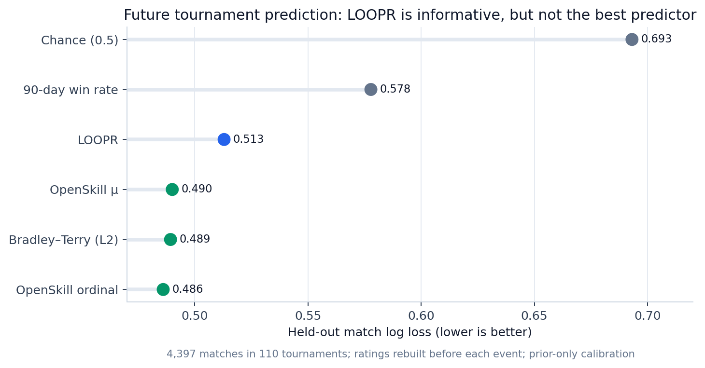
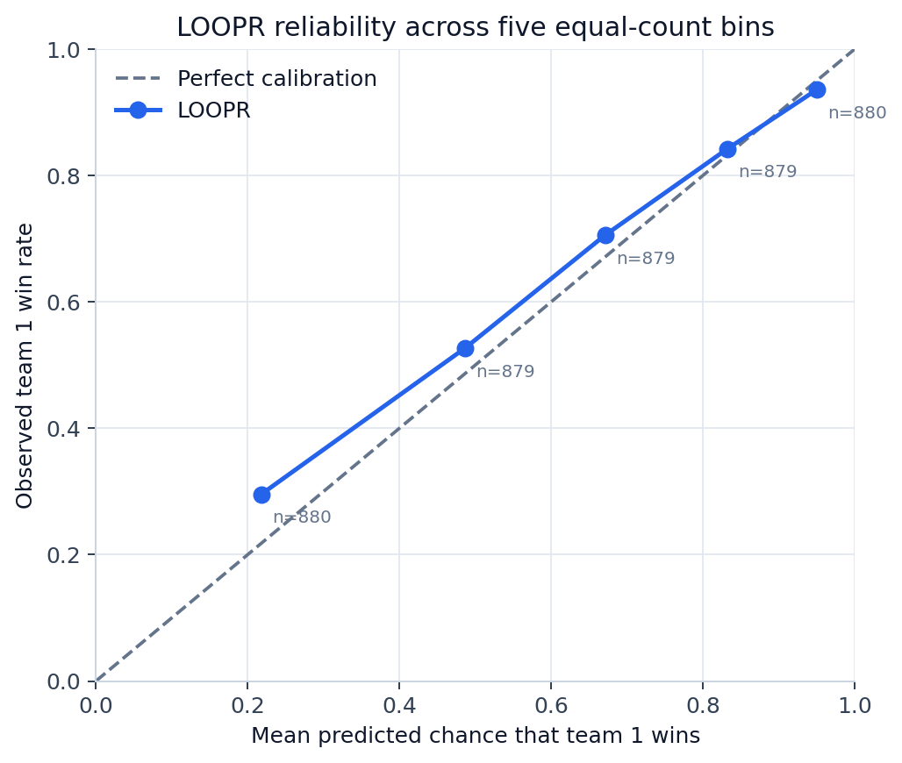
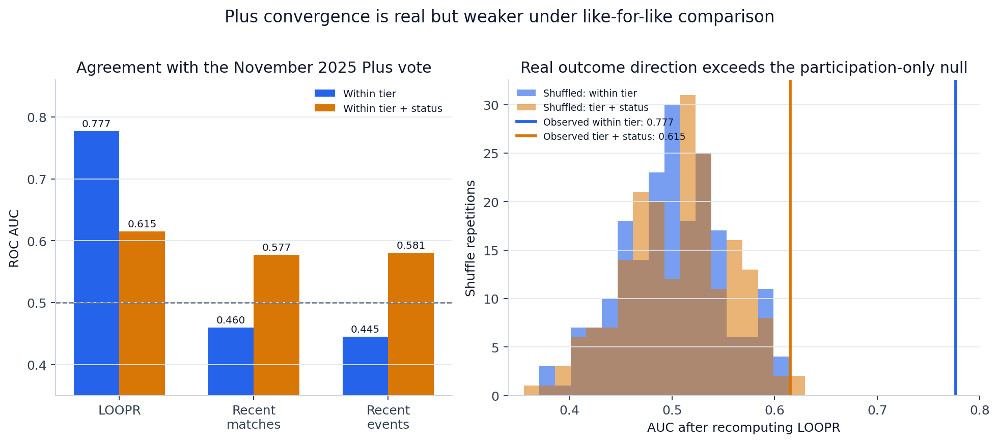
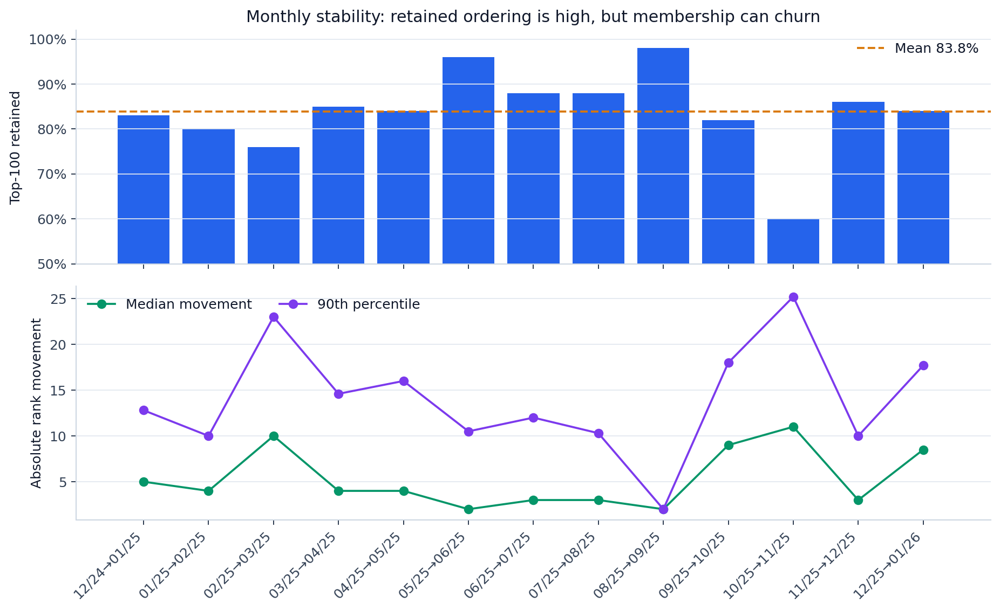
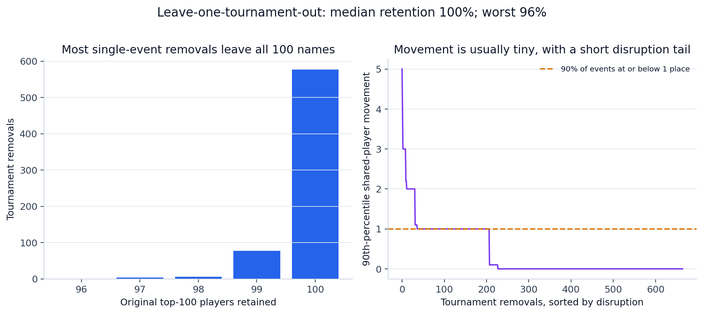
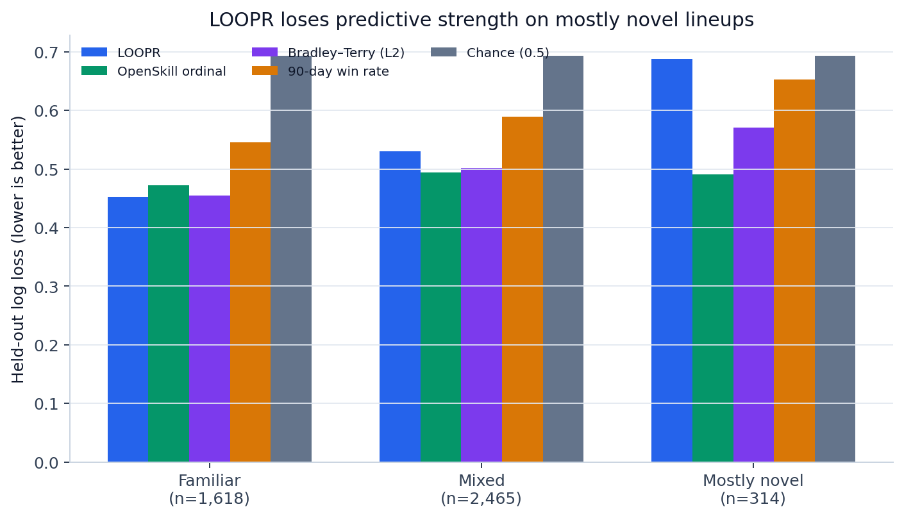
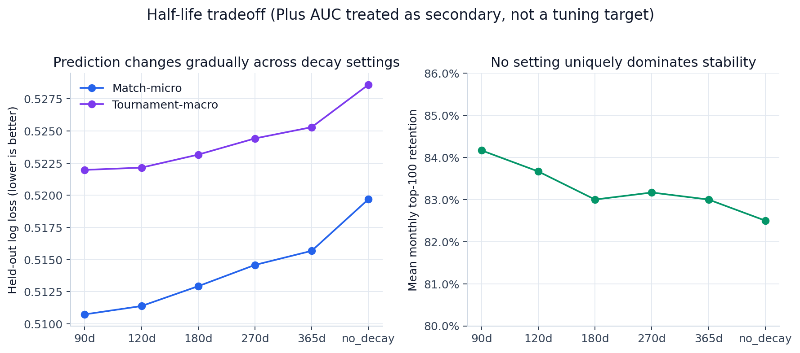

# Building Public Rankings, Part I: empirical audit

**Data cutoff:** 2026-01-28  
**Primary held-out window:** 2025-08-17 to 2026-01-28  
**Unit of temporal holdout and prediction resampling:** tournament  
**Random seed:** 20260731

## Answer first

LOOPR is a meaningful outcome-derived measurement instrument, but this audit does not support calling it the best predictor or treating its exact public ordering as objective.

The strongest defensible construct statement is:

> **LOOPR estimates a player’s demonstrated ability to convert organized-play match opportunities into tournament victories, given the available network of teammates, opponents, events, and results.**

Why the positive part is defensible:

- LOOPR predicts later matches much better than chance (log loss 0.513 versus 0.693) and recent win rate (0.578).
- Institutional Plus agreement is substantial (macro AUC 0.777), and both that result and the stricter tier/status AUC (0.615) exceed full outcome-shuffle nulls.
- The final top 100 is usually insensitive to any one event: median leave-one-event retention is 100%, worst 96%.
- Residual association with match volume is tiny after basic record/schedule controls, and matched schedule comparisons usually move in the intended direction.

Why the boundary matters:

- OpenSkill ordinal (0.486), OpenSkill μ (0.490), and regularized Bradley–Terry (0.489) all predict held-out matches more accurately by paired tournament comparison.
- Like-for-like Plus agreement is only moderate, and LOOPR’s advantage over activity-only measures is not clearly resolved there.
- Mostly novel lineups are near chance for LOOPR (log loss 0.688).
- Top-100 ordering among retained players is high (mean Spearman 0.965), but membership retention averages 83.8% and reaches a low of 60%.
- The current tests do not establish that smoothing or tournament weighting achieves its intended protection.

“Strong skill-o-meter” is therefore defensible only if *strong* means that several distinct, falsifiable tests show substantial organized-play information. It is not defensible if it means best-in-class prediction, context-free individual skill, every exact neighboring rank, or public-leaderboard legitimacy.

## Main-path exhibit 1 — What the dataset can see

| Measure | Result | What it means |
| --- | --- | --- |
| Largest weak component | 5,518 / 5,518 players (100%) | The organized-play graph is connected enough for results to propagate. |
| Top 100 in that component | 100 / 100 | Every displayed top player is connected to the same result network. |
| Plus candidates in graph | 459 / 468 (98.1%) | Nine historical candidates never appear in a resolved eligible match. |
| Unique teammates | median 6; IQR 3–14 | The typical player changes teammates, but mixing varies greatly. |
| Unique opponents | median 48; IQR 20–151 | Most players connect to many opponents. |
| Distinct lineups | median 3; IQR 1–8 | Many players supply more than one lineup context. |
| Most-common-lineup share | median 53.8%; IQR 28.3–100% | A quarter of players never leave their most common recorded lineup. |
| Persistent lineup | 841 players (15.2%) | At least 80% of matches use one lineup (flag requires ≥5 matches). |
| Near-inseparable teammate | 1,746 players (31.6%) | One teammate appears in at least 90% of matches (flag requires ≥5 matches). |

**Formal metric.** Weak graph components, teammate/opponent counts, lineup diversity, and concentration.  
**Plain-language question.** Do players mix enough for team results to say something about individuals?  
**Interpretation.** Everyone connects to one graph and the typical player has several teammate contexts, but a meaningful minority is nearly inseparable from a teammate or lineup.  
**Limitation.** Connectivity permits propagation; it does not guarantee precise separation of players who nearly always appear together. Only 9.6% of matches have exact appearance lineups on both sides.

## Main-path exhibit 2 — Future prediction

| System | Match-micro log loss | Tournament-macro log loss | Brier | Accuracy | Paired Δ vs LOOPR | Δ CI low | Δ CI high | Events beating LOOPR | Median event Δ |
| --- | --- | --- | --- | --- | --- | --- | --- | --- | --- |
| LOOPR | 0.513 | 0.523 | 0.170 | 0.748 | 0.000 | 0.000 | 0.000 | 0 | 0.000 |
| Bradley–Terry (L2) | 0.489 | 0.502 | 0.163 | 0.749 | -0.024 | -0.038 | -0.010 | 71 | -0.011 |
| OpenSkill μ | 0.490 | 0.503 | 0.163 | 0.753 | -0.023 | -0.035 | -0.010 | 70 | -0.020 |
| OpenSkill ordinal | 0.486 | 0.508 | 0.161 | 0.755 | -0.027 | -0.046 | -0.008 | 62 | -0.009 |
| 90-day win rate | 0.578 | 0.586 | 0.197 | 0.688 | 0.065 | 0.047 | 0.082 | 23 | 0.052 |
| Chance (0.5) | 0.693 | 0.693 | 0.250 | 0.500 | 0.180 | 0.150 | 0.206 | 7 | 0.191 |

**Formal metric.** Match-weighted log loss is primary; tournament-weighted log loss, Brier score, and 0/1 accuracy are supplementary. Paired differences are method minus LOOPR, so negative favors the comparator.  
**Plain-language question.** Before a tournament starts, does the rating put sensible probabilities on who will win?  
**Interpretation.** LOOPR contains substantial predictive information beyond chance and recent win rate, but the available data clearly favor all three stronger identity-only baselines on log loss.  
**Limitation.** Prediction validates information about future outcomes, not an objective skill vector or every exact rank. The evaluation covers 110 tournaments, not every future metagame.

The comparator advantage is not a large-event artifact: tournament-macro loss preserves the direction. OpenSkill ordinal beats LOOPR in 62 of 110 tournaments, OpenSkill μ in 70, and Bradley–Terry in 71. Their median per-event advantages are smaller than the match-micro averages, so both summaries are shown.

## Main-path exhibit 3 — Probability reliability

**Formal metric.** Five equal-count reliability bins compare mean predicted favorite probability with observed favorite win rate.  
**Plain-language question.** When LOOPR says “about 70%,” does that kind of favorite win about 70% of the time?  
**Interpretation.** The curve is monotone and reasonably close to the diagonal, but lower/middle bins are underconfident and the top bin is slightly overconfident.  
**Limitation.** Five bins summarize average behavior and can hide within-bin heterogeneity; calibration was learned from earlier events only.

## Main-path exhibit 4 — Plus convergence and negative control

| System | Candidates | Institutional macro AUC | Macro CI low | Macro CI high | Like-for-like AUC | Stratified CI low | Stratified CI high |
| --- | --- | --- | --- | --- | --- | --- | --- |
| LOOPR | 310 | 0.777 | 0.719 | 0.831 | 0.615 | 0.523 | 0.707 |
| 90-day win rate | 310 | 0.505 | 0.432 | 0.576 | 0.528 | 0.443 | 0.610 |
| Matches in prior 90d | 310 | 0.460 | 0.390 | 0.533 | 0.577 | 0.489 | 0.660 |
| Tournaments in prior 90d | 310 | 0.445 | 0.377 | 0.518 | 0.581 | 0.492 | 0.662 |

**Formal metric.** ROC AUC asks whether a passer receives a higher score than a failer. Institutional macro AUC gives each tier equal weight when averaging its pair-ordering probability; like-for-like AUC compares within tier and candidate status, weighted by available passer–failer pairs.  
**Plain-language question.** Does LOOPR tend to order candidates the same way this consequential peer-vote process did?  
**Interpretation.** Within tier, LOOPR agreement is substantial and much higher than exposure alone. Under like-for-like comparison, agreement is moderate and the advantage over activity is uncertain. Both observed measures exceed the 200-run outcome-shuffle null, so win/loss direction adds information beyond participation structure.  
**Limitation.** AUC is not percent accuracy, does not validate adjacent ranks, and covers one historical vote among 310 active candidates. Vote percentages are unavailable.

## Main-path exhibit 5 — Monthly stability

| Month A | Month B | Retained | Retained-player Spearman | Median move | 90th-pct move |
| --- | --- | --- | --- | --- | --- |
| 2024-12-31 | 2025-01-31 | 83 | 0.988 | 5.0 | 12.8 |
| 2025-01-31 | 2025-02-28 | 80 | 0.958 | 4.0 | 10.0 |
| 2025-02-28 | 2025-03-31 | 76 | 0.883 | 10.0 | 23.0 |
| 2025-03-31 | 2025-04-30 | 85 | 0.950 | 4.0 | 14.6 |
| 2025-04-30 | 2025-05-31 | 84 | 0.937 | 4.0 | 16.0 |
| 2025-05-31 | 2025-06-30 | 96 | 0.973 | 2.0 | 10.5 |
| 2025-06-30 | 2025-07-31 | 88 | 0.954 | 3.0 | 12.0 |
| 2025-07-31 | 2025-08-31 | 88 | 0.987 | 3.0 | 10.3 |
| 2025-08-31 | 2025-09-30 | 98 | 1.000 | 2.0 | 2.0 |
| 2025-09-30 | 2025-10-31 | 82 | 0.992 | 9.0 | 18.0 |
| 2025-10-31 | 2025-11-30 | 60 | 0.979 | 11.0 | 25.2 |
| 2025-11-30 | 2025-12-31 | 86 | 0.988 | 3.0 | 10.0 |
| 2025-12-31 | 2026-01-28 | 84 | 0.952 | 8.5 | 17.7 |

**Formal metric.** Top-100 retention measures membership; Spearman measures ordering only among retained players; median and 90th-percentile absolute movement measure typical and upper-tail change.  
**Plain-language question.** Does the list remain recognizable from month to month without becoming frozen?  
**Interpretation.** Retained players are usually ordered similarly, but membership churn is meaningful and occasionally large.  
**Limitation.** Stability is operational, not accuracy. The 90-day activity rule is itself a source of entry and exit.

## Main-path exhibit 6 — Leave-one-tournament-out robustness

| Measure | Result |
| --- | --- |
| Median top-100 retention | 100% |
| Worst top-100 retention | 96% (Crobattle Royale: Mel0's Birthday Edition (28th)) |
| Median of per-event median movements | 0 places |
| 90th percentile of per-event 90th-percentile movement | 1 place |
| Largest shared-player shift | 63 places (Baja's Blast #31) |
| Events changing top-100 rank eligibility | 18 / 665 |

**Formal metric.** Each eligible event is removed and the full graph/tick-tock pipeline is recomputed; retention and rank movement compare with the full-data final ranking.  
**Plain-language question.** Is the final top 100 broadly supported by the network, or can one event rewrite it?  
**Interpretation.** Most removals have negligible effect, but a small tail creates material shared-player shifts or changes 90-day rank eligibility.  
**Limitation.** This is sensitivity analysis, not a confidence interval, and it tests one event at a time rather than coordinated data errors or missing regions.

## Technical collapsible A — Plus strata

| comparison | tier | suggested | n | pass | fail | auc | ci_low | ci_high | pairs |
| --- | --- | --- | --- | --- | --- | --- | --- | --- | --- |
| tier | 1 | all | 58 | 42 | 16 | 0.783 | 0.659 | 0.896 | — |
| tier | 2 | all | 86 | 41 | 45 | 0.819 | 0.727 | 0.901 | — |
| tier | 3 | all | 166 | 115 | 51 | 0.729 | 0.658 | 0.796 | — |
| tier_status | 1 | incumbent | 47 | 40 | 7 | 0.657 | 0.432 | 0.854 | 280.0 |
| tier_status | 1 | suggested | 11 | 2 | 9 | 0.833 | 0.556 | 1.000 | 18.0 |
| tier_status | 2 | incumbent | 54 | 36 | 18 | 0.761 | 0.611 | 0.890 | 648.0 |
| tier_status | 2 | suggested | 32 | 5 | 27 | 0.763 | 0.533 | 0.956 | 135.0 |
| tier_status | 3 | incumbent | 116 | 97 | 19 | 0.544 | 0.386 | 0.698 | 1843.0 |
| tier_status | 3 | suggested | 50 | 18 | 32 | 0.618 | 0.458 | 0.764 | 576.0 |

The +1-suggested cell has only two passers and nine failers. Pair weighting prevents that tiny high-AUC cell from dominating the aggregate. The large +3-incumbent cell is near chance (AUC 0.544), an important reason the stricter aggregate is lower.

## Technical collapsible B — Transfer to unfamiliar lineups

| familiarity_group | matches | log_loss | accuracy |
| --- | --- | --- | --- |
| familiar | 1618 | 0.452 | 78.7% |
| mixed | 2465 | 0.530 | 73.6% |
| mostly novel | 314 | 0.688 | 63.4% |

**Formal metric.** Prior teammate familiarity is the fraction of the six pairings in a four-player lineup with earlier shared-match history, averaged across both teams.  
**Plain-language question.** Does the rating still help when players form new teammate combinations?  
**Interpretation.** LOOPR is strong on familiar lineups, weaker on mixed ones, and nearly chance on mostly novel lineups.  
**Limitation.** The mostly novel group has only 314 matches, and roster fallback may misclassify familiarity when substitutions are missing.

## Technical collapsible C — Half-life tradeoff

| setting | half_life_days | match_micro_log_loss | tournament_macro_log_loss | mean_monthly_top100_retention | median_monthly_rank_movement | plus_institutional_macro_auc_secondary | plus_like_for_like_auc_secondary |
| --- | --- | --- | --- | --- | --- | --- | --- |
| 90d | 90.000 | 0.511 | 0.522 | 0.842 | 5.500 | 0.770 | 0.622 |
| 120d | 120.000 | 0.511 | 0.522 | 0.837 | 6.500 | 0.778 | 0.622 |
| 180d | 180.000 | 0.513 | 0.523 | 0.830 | 5.750 | 0.777 | 0.615 |
| 270d | 270.000 | 0.515 | 0.524 | 0.832 | 5.000 | 0.777 | 0.616 |
| 365d | 365.000 | 0.516 | 0.525 | 0.830 | 5.000 | 0.776 | 0.614 |
| no_decay | — | 0.520 | 0.529 | 0.825 | 5.500 | 0.775 | 0.612 |

**Formal metric.** The same strict walk-forward prediction and monthly stability calculations are repeated for six decay settings.  
**Plain-language question.** Is 180 days uniquely best, or one reasonable continuity/recency compromise?  
**Interpretation.** Shorter decay predicts slightly better; stability differences are small and non-monotone. Several settings are plausible.  
**Limitation.** The sweep does not define a single utility function for prediction versus continuity. Plus AUC is secondary and was not used as an independent validation target after tuning.

## Technical collapsible D — Requirement-specific property tests

### Strength of schedule

- 2,793 approximate real-player matched comparisons.
- Stronger-schedule player ranks higher in 72.8%.
- Median score advantage 0.304.

This supports intended directional behavior. It is descriptive, reuses players, and conditions on model-derived opponent scores.

### Volume resistance

- 3,120 players with at least ten matches.
- Standardized log-match coefficient -0.009 after controls.
- Partial R² 0.00025.

The residual is tiny, supporting volume resistance. It does not prove exact mathematical cancellation or remove opportunity bias.

### Limited evidence and smoothing

| exposure_band | smoothing | players | median_absolute_score_change | p90_absolute_score_change | median_absolute_rank_change | p90_absolute_rank_change | disappeared |
| --- | --- | --- | --- | --- | --- | --- | --- |
| high | False | 6 | 0.036 | 0.054 | 29.0 | 192.5 | 0 |
| high | True | 6 | 0.035 | 0.053 | 30.5 | 193.5 | 0 |
| low | False | 6 | 0.032 | 0.117 | 54.5 | 138.0 | 0 |
| low | True | 6 | 0.032 | 0.116 | 53.5 | 143.0 | 0 |
| medium-high | False | 6 | 0.095 | 1.295 | 148.5 | 630.0 | 0 |
| medium-high | True | 6 | 0.094 | 1.291 | 149.0 | 635.0 | 0 |
| medium-low | False | 6 | 0.031 | 0.077 | 29.5 | 104.5 | 0 |
| medium-low | True | 6 | 0.030 | 0.076 | 29.5 | 101.5 | 0 |

Across 24 sampled players, smoothing and no-smoothing changes are nearly identical. This test does not demonstrate that the current smoothing implementation limits low-evidence perturbations. The sample is small and rank changes are noisy.

### Tournament-strength weighting

The eight lowest- and eight highest-influence event removals do not show a clean weak-event-damping pattern. Because event groups are defined by fitted influence and the signed contribution statistic is endogenous, this is inconclusive. The article should explain the intended design without claiming complete farming or Goodhart resistance.

## Claim-level conclusion

The evidence primarily supports:

1. LOOPR contains competitive information.
2. LOOPR supports broad ordinal distinctions about demonstrated organized-play success.

It does not establish:

3. That every exact pairwise rank is meaningful.
4. That publishing the ordering as a named public leaderboard is legitimate.

Those are not statistical footnotes. They are the bridge from Part I to Part II.

## Audit trail

- [Evaluation manifest](evaluation_manifest.json)
- [Data and methodology audit](data_methodology_audit.md)
- [Claim ledger](claim_ledger.md)
- [Proposed revised evaluation section](revised_evaluation_section.md)
- [Machine-readable results](results/results.json)
- [Reproduction ledger](audit/reproduction_ledger.csv)
- [Prior-materials inventory](audit/project_file_inventory.csv)
- [Runnable analysis README](README.md)
